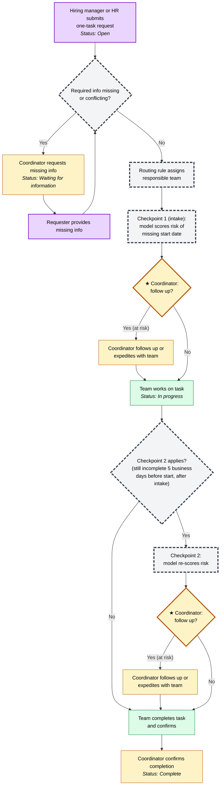

# Workflow Diagram – Onboarding Request Routing and Follow-Up

### Legend

| Colour / style | Role |
|:---|:---|
| 🟪 Purple | Requester (hiring manager or HR staff) |
| ⬜ Grey, dashed border | System (routing rule, information check, risk model) |
| 🟨 Yellow | Coordinator |
| 🟩 Green | Responsible team |

| Shape / marker | Meaning |
|:---|:---|
| ▭ Rectangle | A step or action |
| ◇ Diamond | A yes/no decision point |
| ★ Bold border | Key decision: coordinator reviews the model's suggestion |

**Notes:** The coordinator confirms the routing rule's team when reviewing checkpoint 1. Low model confidence or an unusual case adds a flag for coordinator review at either checkpoint. Each request has at most two assessments. Checkpoint 2 only applies if it falls after the intake assessment and the task is still incomplete. Requests received at or after that checkpoint receive only the intake assessment. All suggested actions require human confirmation. 

Timestamps recorded at every status change · Synthetic data only · Fictional Town of Pinecrest · No connection to real HR/ERP systems.
