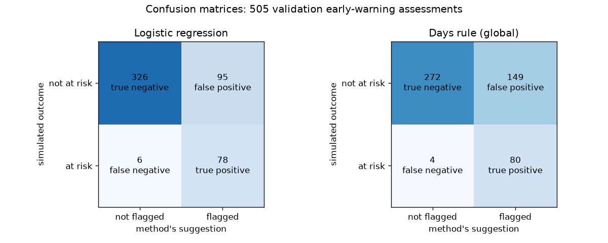

# AIDA 1141 Project Exercise 07 – Evaluation Measures

## Use-case question

How do the Exercise 06 model and Exercise 05 rules compare using confusion matrices and classification measures, and which errors matter most to the fictional coordinator?

## Intended staff decision

The coordinator decides whether to follow up on an onboarding task. These measures show the trade-off between missed warnings and unnecessary review flags.

## Steps completed

1. Loaded saved validation predictions and confirmed the confusion counts matched Exercise 06.
2. Built confusion matrices for the model and both days rules.
3. Calculated classification metrics and threshold-independent ranking measures.
4. Aggregated flags by task and compared first-flag weekday counts.
5. Calculated cost-sensitivity ratios and documented which errors matter most.

## Result

On 505 early-warning assessments, the model achieved 92.9% recall and 45.1% precision, compared with 95.2% and 34.9% for the global days rule. The model also had higher observed specificity and F1, with ROC AUC of 0.941 and average precision of 0.807, compared with 0.882 and 0.629 for the days score.

At task level, the rule flagged all 64 at-risk tasks, while the model flagged 62, leaving one payroll setup and one workplace access task without a model warning. Of the 62 at-risk tasks both methods flagged, 58 had the same weekday count at first flag. Under the stated cost assumptions, the break-even ratios were 20 at task level and 27 at assessment level.

- [Notebook](evaluation_measures.ipynb)
- [Assessment confusion matrices](outputs/confusion_matrices_assessments.csv)
- [Confusion matrix chart](outputs/confusion_matrices.png)
- [Assessment metrics](outputs/metrics_assessments.csv)
- [Ranking measures](outputs/ranking_measures.csv)
- [Task confusion and metrics](outputs/confusion_and_metrics_tasks.csv)
- [Task lead time](outputs/task_lead_time.csv)
- [Missed at-risk tasks](outputs/missed_at_risk_tasks.csv)
- [Break-even ratios](outputs/break_even.csv)
- [Cost sensitivity](outputs/cost_sensitivity.csv)
- [Cost sensitivity chart](outputs/cost_sensitivity.png)

## Which errors matter most

False negatives are the main concern because a missed warning may leave an employee without needed payroll, access, equipment, or orientation setup if staff do not otherwise notice the task. This supports the 90% recall target for early-warning assessments. Consequences may differ by task type, although this analysis treats misses equally.

False positives may create avoidable review work, but flag counts do not measure staff time. Under the simplified cost assumptions, the global rule has lower calculated cost when one missed task costs more than 20 unnecessary task flags; the assessment-level ratio is 27. Below each ratio, the model has lower calculated cost, and at the ratio they tie. The results do not select a preferred method without the team’s priorities or cost assumptions.

## What the result means

Both methods met the assessment-level recall target. The model reduced flags but left two at-risk tasks unflagged, creating a trade-off for the fictional team.

Exercise 08 will review the errors, and Exercise 09 will compare thresholds on validation before final test evaluation. A flag before the deadline does not establish that enough time remained for effective intervention.

## Limitation

The task-level difference rests on two tasks in a small validation sample of simulated outcomes, with related assessments from the same tasks and employees. It should not be treated as a reliable estimate of performance differences. Employees are separated across splits, but the splits cover overlapping dates, so results assess held-out employees within the simulated period rather than performance on a later period or under changing conditions.

## Human reviewer action

Decide how many unnecessary task flags the fictional team would accept to avoid one missed at-risk task, to inform threshold selection in Exercise 09.

## Run instructions

Use the project-root `.venv` (Python 3.14.7) with scikit-learn 1.9.1, pandas 3.0.6, NumPy 2.5.3, Matplotlib 3.11.2, and ipykernel 7.4.0, installed from the tech guide's package list.

The notebook reads:

- `../06-model-training-and-split/outputs/validation_predictions.csv`
- `../06-model-training-and-split/outputs/model_vs_baselines.csv`
- `../02-synthetic-request-records/data/assessments.csv`
- `../02-synthetic-request-records/data/requests.csv`

Run Exercise 06 first. Open `evaluation_measures.ipynb`, select the `.venv` kernel, restart it, and run all cells. Relative paths assume the working directory is this exercise folder.

The notebook creates `outputs/` if needed and overwrites matching output files. It does not refit models, change thresholds, or evaluate test data.
