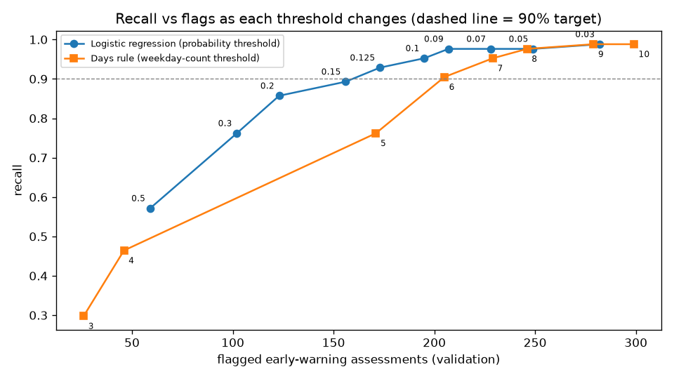

# AIDA 1141 Project Exercise 09 – Review Queue and Threshold

## Use-case question

Which flagging thresholds and review rules should decide which onboarding assessments are suggested for follow-up, which receive a second look, and which are left for normal monitoring?

## Intended staff decision

The coordinator decides whether to follow up on an onboarding task. The review policy decides how prominently each assessment is shown. Follow-up suggestions are generated automatically, but no follow-up is automatic; a person confirms every follow-up.

## Steps completed

1. Checked inputs and recorded package versions, and confirmed the saved Exercise 06 model reproduced its validation probabilities.
2. Compared model and days-rule thresholds on validation early-warning assessments.
3. Tuned both methods to the fewest flags reaching 90% validation recall and defined a three-tier candidate review policy.
4. Reviewed the candidate policy's review volume, review reasons, and tier sizes on validation.
5. Froze the policy before first examining test performance; subsequent unchanged runs checked reproducibility.

## Result

On validation, the selected thresholds were a model probability of approximately 0.1463 and 6 or fewer weekday counts for the days rule; each flagged 76 of 84 at-risk assessments (90.5%). Model tier 1 alone selected 159 of 505 assessments for review but left two at-risk tasks without an early-warning review flag. The full model queue (tiers 1 and 2) selected 251 assessments for review (49.7%), flagged 83 of 84 at-risk assessments, and left no at-risk task without an early-warning review flag, compared with 205 assessments selected by the days rule.

On the test set (502 early-warning assessments, 78 at risk; 12 overdue counted separately), tier 1 alone reached 83.3% recall, below the target, and left five at-risk tasks without an early-warning review flag. The full model queue reached 93.6% recall with 248 assessments selected for review (49.4%); the days rule reached 89.7% with 201 selected. Neither left an at-risk task without an early-warning review flag.

- [Notebook](review_queue_threshold.ipynb)
- [Threshold comparison](outputs/threshold_comparison_validation.csv)
- [Threshold trade-off chart](outputs/threshold_tradeoff.png)
- [Validation policy comparison](outputs/policy_comparison_validation.csv)
- [Review-reason overlap](outputs/review_reason_overlap_validation.csv)
- [Validation tier summary](outputs/tier_summary_validation.csv)
- [Example review queue](outputs/example_review_queue.csv)
- [Frozen policy](outputs/frozen_policy.json)
- [Test results](outputs/test_results.csv)
- [Test predictions](outputs/test_predictions.csv)
- [Validation vs test](outputs/validation_vs_test.csv)

## Review policy

- **Overdue (urgent review):** already at or past the deadline; the coordinator reviews it.
- **Tier 1 – Follow-up suggested:** estimated risk at or above the model threshold.
- **Tier 2 – Second look:** not tier 1, but near the threshold (from half the threshold up to, but below, the threshold), flagged by the days rule, or high impact (2 or fewer weekday counts for any task, or 5 or fewer for payroll, system access, or workplace access). The near-threshold band is exploratory, not a confidence measure.
- **Tier 3 – No flag:** remains visible for normal monitoring.

These tiers answer the exercise's routing question: tier 1 cases are generated automatically as follow-up suggestions, which a person confirms, while tier 2 cases must go to a person for a second look before any decision. Near-threshold cases serve as the low-confidence (borderline) cases, cases where the model and days rule disagree are the ambiguous cases, and the high-impact condition covers high-impact cases.

For retrospective task summaries, each task receives the highest-priority tier assigned across its early-warning assessments. The tiers and high-impact rule are fictional prioritization assumptions. On validation, the high-impact rule added no assessments beyond the other two reasons but remains as a documented review condition.

## Freezing and test use

All thresholds and tier settings were chosen on validation and frozen in `frozen_policy.json` before test performance was first examined. Before test scoring, the notebook reloads the frozen file and stops if the policy or any fingerprint differs. Test results are reported as observed; no setting was changed afterwards.

## What the result means

Tier 1 did not meet the 90% test recall target. The full model queue achieved 93.6%, selecting 47 more assessments for review than the days rule and flagging three additional at-risk assessments. Both policies flagged every at-risk task at least once, so the full queue caught no additional at-risk tasks. Its proposed prioritization benefit was not measured as an operational outcome.

## Limitation

The test set contains 78 at-risk assessments from simulated outcomes, clustered by task and employee, and its splits cover overlapping dates. Small differences between policies are uncertain and do not show performance in a later period or on real onboarding data.

## Human reviewer action

Decide whether selecting about half of early-warning assessments for review is manageable for the fictional coordinator, and whether the full model queue's additional selections over the days rule are justified by its proposed prioritization.

## Run instructions

Use the project-root `.venv` (Python 3.14.7) with scikit-learn 1.9.1, pandas 3.0.6, NumPy 2.5.3, SciPy 1.18.1, joblib 1.6.0, Matplotlib 3.11.2, and ipykernel 7.4.0. The notebook stops if the installed versions of the five packages recorded with the Exercise 06 model (scikit-learn, pandas, NumPy, joblib, and SciPy) differ from those records.

The notebook reads:

- `../02-synthetic-request-records/data/requests.csv`
- `../02-synthetic-request-records/data/assessments.csv`
- `../05-simple-routing-baseline/outputs/employee_split.csv`
- `../05-simple-routing-baseline/outputs/rule_thresholds.csv`
- `../06-model-training-and-split/outputs/feature_list.csv`
- `../06-model-training-and-split/outputs/model_settings.csv`
- `../06-model-training-and-split/outputs/validation_predictions.csv`
- `../06-model-training-and-split/outputs/model.joblib`

Run Exercises 05 and 06 first. Open `review_queue_threshold.ipynb`, select the `.venv` kernel, restart it, and run all cells. Relative paths assume the working directory is this exercise folder. Load `model.joblib` only in a trusted environment.

The notebook creates `outputs/` if needed. It writes `frozen_policy.json` on the first run; later runs confirm the rebuilt policy and fingerprints match it and stop if they differ. The other nine output files are overwritten on each run, and reruns repeat the same test evaluation using the frozen settings without retuning.
