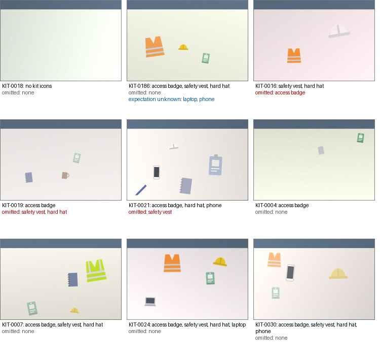

# AIDA 2154 Project Exercise 01 – Synthetic Image Specification

## Use-case question

Can a classical vision method identify which first-day kit icons appear on a generated card when size, position, and contrast vary?

## Intended staff decision

The coordinator decides whether to request clarification or check an actual kit when an expected item appears missing, unclear, or unexpected. This is a proposed workflow using synthetic cards.

## Steps completed

1. Defined the visual question and five icon classes following instructor approval.
2. Derived expected kits from AIDA 1141 Exercise 02 records using documented, invented rules.
3. Generated 500 cards with simulated omissions and varied icon size, position, and contrast.
4. Created a fixed 60/20/20 split, approximately stratified by field department and whether any item was omitted.
5. Documented labels, edge cases, planned evaluation measures, and human-review rules.
6. Reviewed the generator and added training-only examples, clearer captions, and links to source request IDs.

## Result

The generator produced 500 cards containing 1,007 icons, with 161 expected items deliberately omitted. The fixed split contains 300 training, 100 validation, and 100 test cards.

The full dataset was generated following instructor approval to proceed beyond a tiny feasibility sample, establishing the split before comparing the baseline and classical method. No detection performance has been measured yet.

- [Data card](data-card.md)
- [Label guide](label-guide.md)
- [Human review note](human-review-note.md)
- [Generator](generate_kit_cards.py)
- [Manifest](manifest.csv)
- [Icon instances](icon_instances.csv)
- [Example cards](outputs/example_cards.png)



## What the result means

The images and documentation provide the starting point for Exercise 02’s quality and preprocessing checks. Later exercises will reuse the fixed split to compare methods and examine errors under the generated variations.

## Limitation

The kit rules and omission probability are invented, so results will describe this generated dataset rather than real onboarding kits.

## Human reviewer action

Check a wider sample of training cards containing small and low-contrast examples of each icon to confirm they are visible to a person, keeping test cards held back for final evaluation.

## Run instructions

Use the project-root `.venv` (Python 3.14.7) with Pillow 12.3.0, which was installed alongside Matplotlib and is listed in the tech guide. The generator otherwise uses only Python’s standard library.

It reads:

```
../../../AIDA-1141/project-labs/02-synthetic-request-records/data/requests.csv
```

From this exercise folder, with the `.venv` activated, run:

```
python generate_kit_cards.py
```

The relative paths assume the working directory is this exercise folder. The script creates `images/`, `manifest.csv`, `icon_instances.csv`, `reference_icons/`, and `outputs/example_cards.png`, overwriting files with matching names. Seed 2026 reproduces the same files when the source records, script, and environment remain unchanged.
