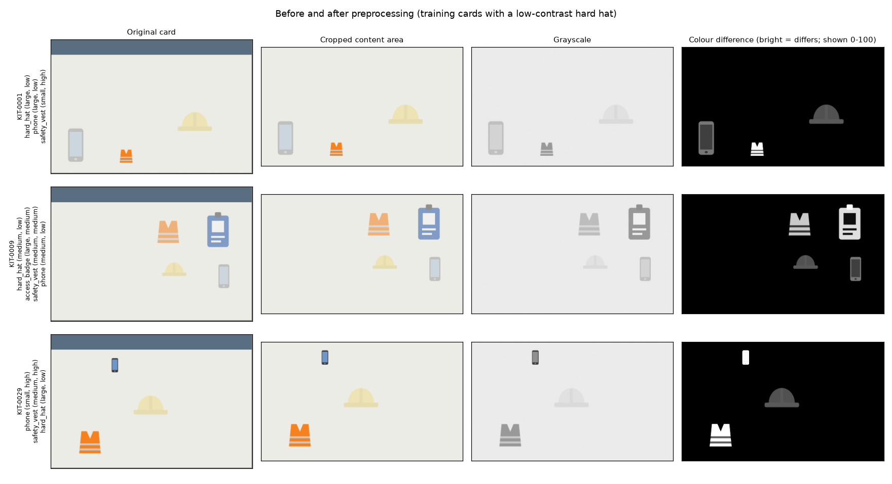

# AIDA 2154 Project Exercise 02 – Image Quality and Preprocessing

## Use-case question

Are the 500 kit-card images complete and consistent, and which preprocessing steps preserve faint icon signals for later vision methods?

## Intended staff decision

The coordinator will later review suggestions about which kit icons appear on a card. This exercise checks image quality and prepares the cards consistently before testing those methods.

## Steps completed

1. Checked that every image exists, passes Pillow verification, opens with OpenCV, and is a 480 × 320 RGB PNG.
2. Checked channel values, background, header, border, and icon placement within the content area.
3. Summarized visual variation across splits without changing the fixed split.
4. Completed a label-blind visibility check of 50 training tiles, including five blank controls, as planned in the Exercise 01 human-review note.
5. Compared training-icon signal in grayscale and colour difference from the background.
6. Defined fixed preprocessing and created before/after examples.
7. Saved the automated checks and supporting summaries.

## Result

All 17 automated checks passed. The 50 pixel-identical blank cards appear across training, validation, and test splits: 27, 13, and 10 respectively.

The test split contains more small icons than training (38.3% versus 32.4%) and more low-contrast icons (32.3% versus 29.2%); any effect on detection will be assessed later. Across contrast levels, the hard hat’s relative signal was about 41% of the strongest icon in grayscale and 97% in colour difference, with 6–9% of its icon pixels matching the background’s grayscale value.

The reviewer identified all 50 visibility tiles correctly, with no unsure answers.

- [Notebook](image_quality_preprocessing.ipynb)
- [Quality summary](outputs/quality_summary.csv)
- [Variation summary](outputs/variation_summary.csv)
- [Size and contrast counts](outputs/size_contrast_counts.csv)
- [Icon contrast](outputs/icon_contrast.csv)
- [Visibility summary](outputs/visibility_summary.csv)
- [Visibility results](outputs/visibility_results.csv)
- [Visibility answers](visibility_review.csv)
- [Before/after examples](outputs/before_after_examples.png)
- [Icon signal chart](outputs/icon_signal.png)
- [Icon positions chart](outputs/icon_positions.png)
- [Visibility sample](outputs/visibility_sample.png)

## Preprocessing rationale

The fixed crop removes the header and border, leaving a 476 × 281 content area. This avoids including header colours that resemble the device icons. Three representations are retained: cropped RGB, grayscale, and colour difference from the known background. Exercises 05 and 06 will compare their usefulness for detection.

No resizing is needed because the cards have consistent dimensions. No noise removal is applied because noise was not added to the generated images. Per-card contrast stretching is avoided so the same pixel colours receive consistent treatment across cards.

Colour-difference values are kept as decimals to preserve small differences. The before/after figure uses different display ranges to help inspect faint icons, so it does not establish which representation performs better. Processed images are recreated when needed rather than saved as another full dataset.

## What the result means

The checks support using these images in later exercises. Grayscale gives some coloured icons a weaker relative signal, which warrants testing during method comparison. Blank-card duplicates and split imbalances will be reported alongside evaluation results.

## Limitation

The visibility check used one reviewer and isolated crops displayed larger than their native pixel dimensions, which may be easier to identify than icons on a full card at normal viewing size.

## Human reviewer action

Review whether the three representations provide a reasonable basis for the later baseline and classical-method comparisons.

## Run instructions

Use the project-root `.venv` (Python 3.14.7) with opencv-python 4.14.0.94, pandas 3.0.6, NumPy 2.5.3, Matplotlib 3.11.2, Pillow 12.3.0, and ipykernel 7.4.0, installed from the tech guide's package list.

The notebook reads the following from `../01-synthetic-image-specification/`:

- `images/`
- `manifest.csv`
- `icon_instances.csv`

It also reads `visibility_review.csv` from this exercise folder. If the file is deleted, the notebook creates a blank answer form and scoring waits for new answers.

Open `image_quality_preprocessing.ipynb`, select the `.venv` kernel, restart it, and run all cells. Relative paths assume the working directory is this exercise folder.

The notebook creates `outputs/` if needed and writes summary CSVs and PNG figures, overwriting matching output files. The recorded visibility answers are preserved.
