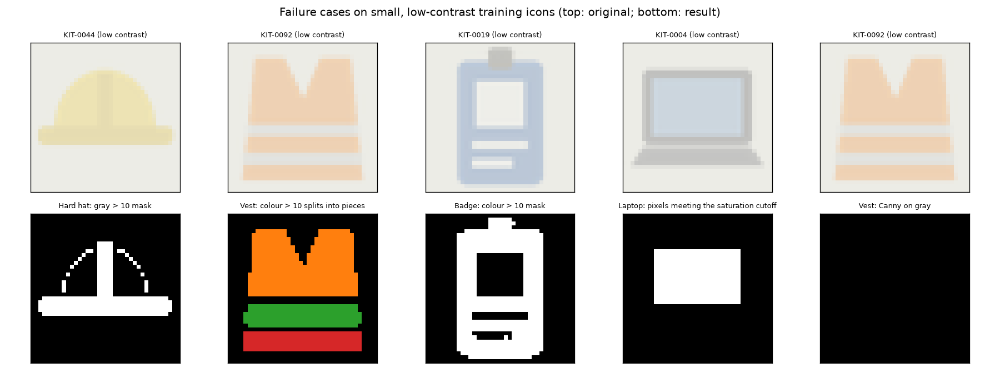

# AIDA 2154 Project Exercise 03 – Visual Feature Inspection

## Use-case question

Which visual features and course-taught filtering steps might distinguish the five kit icons, and where do they fail?

## Intended staff decision

The coordinator will later review suggestions about which icons appear on a card. This exercise explores features that could support those suggestions before a detection method is built.

## Steps completed

1. Reused the Exercise 02 definitions and confirmed the grayscale and colour-difference calculations reproduce its saved summary.
2. Compared foreground-mask thresholds using colour difference and grayscale difference.
3. Measured shape features across the combined foreground, including disconnected pieces.
4. Measured hue and saturation, using a circular average for hue.
5. Applied Canny edge detection to both representations at fixed settings.
6. Recorded parameter notes and summarized failure cases.

All experiments used the 599 training icons within their known rendering boxes.

## Result

The 599 training icons contain only 45 distinct images because each icon, size, and contrast combination is drawn identically. At colour difference > 10, every icon retained a non-empty mask, with median retention of at least 70% for each low-contrast icon type; the low-contrast hard hat retained 44% in grayscale at > 10 and disappeared entirely at > 20.

Combined-foreground aspect-ratio ranges did not overlap between icon types, but all 43 low-contrast vest masks fragmented, changing their measured shape when only the largest piece was used. Hue separated the orange vest and yellow hard hat from the blue icons, whose hue values overlapped, while saturation decreased as contrast fell. Canny at thresholds 50/150 produced no grayscale edges for 81 low-contrast hard hats and vests, whereas colour-difference inputs produced edges for every training icon.

- [Notebook](visual_feature_inspection.ipynb)
- [Feature table](outputs/feature_table.csv)
- [Mask threshold sweep](outputs/mask_threshold_sweep.csv)
- [Edge summary](outputs/edge_summary.csv)
- [Parameter notes](outputs/parameter_notes.csv)
- [Failure cases](outputs/failure_cases.csv)
- [Mask retention chart](outputs/mask_retention.png)
- [Mask examples](outputs/mask_examples.png)
- [Shape features chart](outputs/shape_features.png)
- [Colour features chart](outputs/colour_features.png)
- [Edge examples](outputs/edge_examples.png)
- [Failure-case examples](outputs/failure_cases.png)

## Parameter notes

The main settings and their reasons are recorded in `parameter_notes.csv`. The working colour-difference threshold of 10, saturation cutoff of 20, and Canny thresholds of 50/150 are exploratory settings, not optimized detection parameters. Colour-difference values remain floating point except when converted to 8-bit input for Canny.

## Failure cases

1. Grayscale thresholding removed much of the faint hard hat.
2. All low-contrast vest masks and 12 low-contrast laptop masks split into separate pieces.
3. The low-contrast badge lost foreground pixels, showing how thresholding can change shape measurements.
4. Blue-icon hues overlapped.
5. Only about 45% of the low-contrast laptop’s retained foreground pixels met the saturation cutoff.
6. At the chosen Canny settings, grayscale produced no edges for low-contrast hard hats and vests.

These cases show limitations of individual features and fixed settings, rather than failures of a complete detection method.

## What the result means

The results show useful feature separation when icon locations are already known. They suggest that finding icons on full cards warrants separate testing, and that shape could complement colour when blue-icon hues overlap. The repeated drawings limit how far these observations can be generalized.

## Limitation

Features were measured within generator-provided boxes containing only 45 distinct appearances. The results do not establish performance on full-card detection or more varied images.

## Human reviewer action

Review with the instructor whether the fixed appearances provide an acceptable basis for the baseline and method comparison, with unseen variation tested separately in Exercise 07.

## Run instructions

Use the project-root `.venv` (Python 3.14.7) with opencv-python 4.14.0.94, pandas 3.0.6, NumPy 2.5.3, Matplotlib 3.11.2, and ipykernel 7.4.0, installed from the tech guide's package list.

The notebook reads the following from `../01-synthetic-image-specification/`:

- `images/`
- `manifest.csv`
- `icon_instances.csv`

It also requires `../02-image-quality-and-preprocessing/outputs/icon_contrast.csv` for the consistency check, so run Exercise 02 first.

Open `visual_feature_inspection.ipynb`, select the `.venv` kernel, restart it, and run all cells. Relative paths assume the working directory is this exercise folder.

The notebook creates `outputs/` if needed and overwrites matching CSV summaries and PNG figures on each run.
