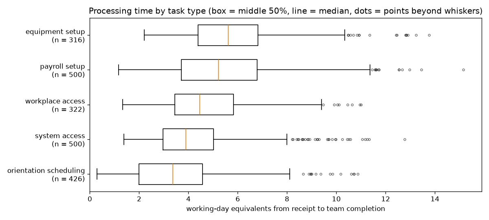

# AIDA 2156 Project Exercise 03 – Processing-Time Distributions

## Use-case question

How long do synthetic onboarding requests take from receipt to team completion, overall and by task type?

## Intended staff decision

The fictional HR team lead would use typical processing times and their spread to plan follow-up timing and set expectations for requesters.

## Steps completed

1. Checked that timestamps were present, in workflow order, and within the Monday–Friday 08:00–16:30 working calendar.
2. Defined working-day equivalents and calendar-day durations, and tested the working-time calculation on constructed examples.
3. Summarized the overall distribution and compared medians by submission weekday.
4. Compared processing times across the five task types.
5. Interpreted centre, spread, and skew, and documented what the results do not prove.

## Result

Across 2,064 requests, the median duration was 4.39 working-day equivalents, compared with a mean of 4.75 and a calendar-day median of 6.16. The middle 50% took 3.13–5.93 working-day equivalents (IQR 2.80), and the 90th percentile was 7.84.

The distribution was right-skewed (0.91), with 3.2% of requests taking more than 10 working-day equivalents. Task-type medians ranged from 3.37 for orientation scheduling to 5.62 for equipment setup; payroll and workplace access had different medians despite sharing the same base processing range.

- [Notebook](processing_time_distributions.ipynb)
- [Duration summary](outputs/duration_summary.csv)
- [Duration by task type](outputs/duration_by_task_type.csv)
- [Distribution plot](outputs/duration_histogram.png)
- [Task-type plot](outputs/duration_by_task_type.png)



## Measure choice

Working-day equivalents count elapsed time within the project’s working calendar and allow durations shorter than one day. Calendar days are retained to describe the requester’s total wait, while whole-date business-day counts would lose partial-day detail.

Calendar medians were about two days lower for Monday submissions (4.26) than for other weekdays (6.15–6.24), while working-day medians stayed between 4.35 and 4.46, so weekends affect calendar time but not working time.

Both measures include waiting for information, assignment, and team processing. Neither represents hours of staff effort.

## What the result means

The median and IQR describe typical simulated processing times with less influence from the longest durations. Differences between task types reflect the generator’s processing ranges and other assumptions; this analysis does not separate their effects.

## What the numbers do not prove

- They do not describe real HR performance or establish that one team is more efficient.
- They do not measure staff effort.
- They do not explain the payroll–workplace access difference or identify causes of the long tail.
- They do not show whether follow-up or expediting would improve completion.
- They describe one simulated sample without uncertainty intervals, so small differences should be interpreted cautiously.

## Limitation

Durations come from invented processing times, delays, and a simplified working calendar. They describe the simulation rather than real onboarding times.

## Human reviewer action

Review whether the generator’s processing-time assumptions are reasonable for the fictional workflow before using these durations in later exercises.

## Run instructions

Use the project-root `.venv` (Python 3.14.7) with pandas 3.0.6, NumPy 2.5.3, Matplotlib 3.11.2, and ipykernel 7.4.0, installed from the tech guide's package list.

The notebook reads `requests.csv` from:

```
../../../AIDA-1141/project-labs/02-synthetic-request-records/data/
```

If the file is missing, run `generate_requests.py` from the AIDA 1141 Exercise 02 folder.

Open `processing_time_distributions.ipynb`, select the `.venv` kernel, restart it, and run all cells. Relative paths assume the working directory is this exercise folder.

The notebook creates `outputs/` if needed and writes `duration_summary.csv`, `duration_by_task_type.csv`, `duration_histogram.png`, and `duration_by_task_type.png`, overwriting matching files on each run.
