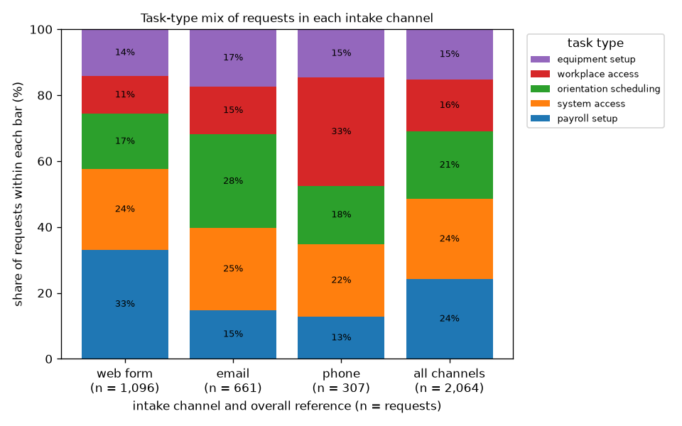

# AIDA 2156 Project Exercise 04 – Category and Channel Relationships

## Use-case question

Do onboarding task types appear in different proportions across the fictional intake channels?

## Intended staff decision

This analysis helps the fictional HR team lead understand which kinds of requests arrive through each intake channel when planning how each channel is monitored and handled.

## Steps completed

1. Loaded the original synthetic `requests.csv` from AIDA 1141 Exercise 02 and checked IDs, categories, and department values; the task type × channel counts matched AIDA 2156 Exercise 01.
2. Built a task type × channel contingency table with row and column totals.
3. Calculated the task-type mix within each channel (main view) and the channel mix within each task type (second view), with counts beside percentages.
4. Created a 100% stacked bar chart with one bar per channel and channel totals.
5. Repeated the main view for the generator's field and office department groups as a short descriptive check.
6. Interpreted the association without claiming causation and documented what the numbers do not show.

## Result

Task types made up different proportions of each channel's requests. Payroll setup was 33.1% of web-form requests (363 of 1,096), compared with 14.8% of email and 12.7% of phone requests. Orientation scheduling was the largest share of email requests (28.4%, 188 of 661), and workplace access was 32.9% of phone requests (101 of 307), about twice its 15.6% overall share. System access (22.1–24.8%) and equipment setup (14.2–17.4%) varied less across channels.

Field departments sent 249 of the 307 phone requests. Workplace access was 36.1% of field phone requests (90 of 249) but 19.0% of office phone requests (11 of 58).

- [Notebook](category_channel_relationships.ipynb)
- [Contingency table](outputs/contingency_counts.csv)
- [Task-type mix by channel](outputs/task_mix_by_channel.csv)
- [Channel mix by task type](outputs/channel_mix_by_task_type.csv)
- [Task-type mix plot](outputs/task_mix_by_channel.png)
- [Department group sizes](outputs/department_group_sizes.csv)
- [Task-type mix by channel and department group](outputs/task_mix_by_channel_and_department_group.csv)
- [Department group plot](outputs/task_mix_by_department_group.png)

## Reading the percentages

The main view divides each task type's requests by the channel's total, so each channel sums to 100%. The second view divides by the task type's total, so each task type sums to 100%; for example, 72.6% of payroll requests arrived by web form, and orientation scheduling was almost evenly split between email (44.1%) and web form (43.2%). Percentages are rounded, so displayed values may not sum to exactly 100%.

No significance test is reported. The question is descriptive, requests are grouped within employees, and the channel differences come from a generator with deliberately different channel probabilities.

## What the result means

Intake channels carry different mixes of onboarding work in this generated dataset. The pattern differs between the generator's field and office department groups, but this comparison is descriptive and does not measure how much department composition explains. The generator's task-type channel adjustments and department settings shape the association; this analysis does not separate their contributions.

## What the numbers do not prove

- They do not show that channel causes task type, or the reverse.
- They do not describe real HR intake.
- They do not separate the effects of task type and department on channel choice.
- Requests are counted individually, but each employee contributes several related tasks, so the rows should not be treated as independent observations.
- Office phone results rest on 58 requests (9–15 per task type) and could change noticeably with a few more or fewer requests.

## Limitation

The association reflects the generator's invented channel settings, and requests are clustered within employees and departments, so it cannot establish channel patterns in real HR intake.

## Human reviewer action

Review whether the generator's task-type and department channel settings are plausible for the fictional municipal workflow.

## Run instructions

Use the project-root `.venv` (Python 3.14.7) with pandas 3.0.6, Matplotlib 3.11.2, and ipykernel 7.4.0, installed from the tech guide's package list.

The notebook reads:

- `../../../AIDA-1141/project-labs/02-synthetic-request-records/data/requests.csv`
- `../01-intake-volume-profile/outputs/intake_counts.csv`

If `requests.csv` is missing, run `generate_requests.py` from the AIDA 1141 Exercise 02 folder. Run AIDA 2156 Exercise 01 first so its count table exists.

Open `category_channel_relationships.ipynb`, select the `.venv` kernel, restart it, and run all cells. Relative paths assume the working directory is this exercise folder.

The notebook creates `outputs/` if needed and overwrites its seven output files on each run.