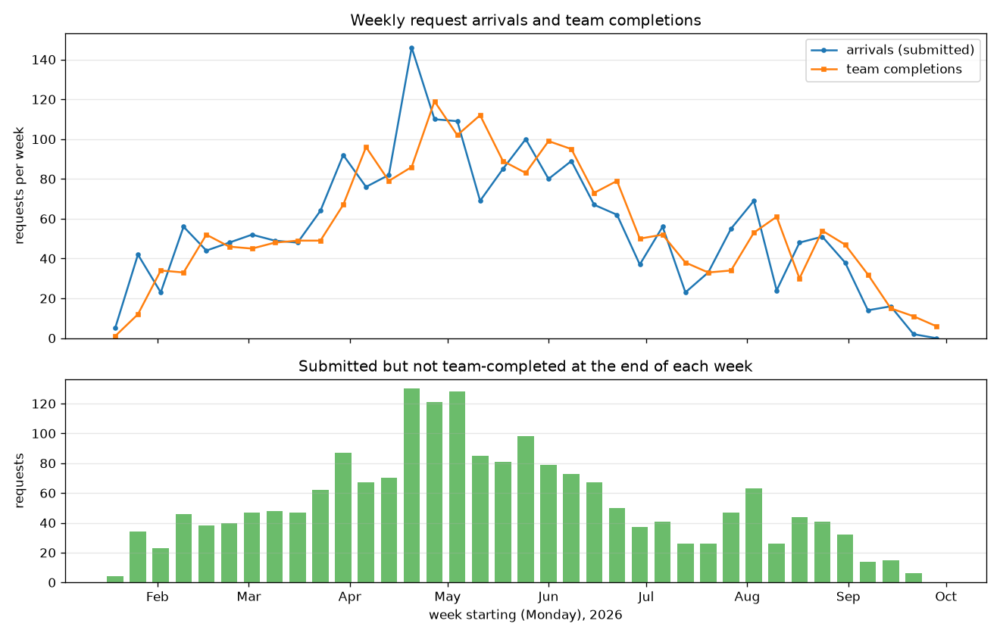

# AIDA 2156 Project Exercise 05 – Weekly Workload Patterns

## Use-case question

How do weekly request arrivals, team completions, and outstanding requests change over the simulated period, and does the time window support a trend claim?

## Intended staff decision

The fictional HR team lead would use the weekly pattern to identify busier periods and plan intake monitoring.

## Steps completed

1. Loaded the original synthetic `requests.csv` from AIDA 1141 Exercise 02 and checked IDs and timestamps.
2. Defined arrival, team completion, Monday–Sunday weeks, and the reporting window.
3. Counted weekly arrivals and team completions, including zero-count weeks.
4. Calculated outstanding requests at each week end and checked that the counts matched the weekly flow.
5. Plotted arrivals and completions with a separate, aligned panel for outstanding requests.
6. Summarized fluctuations and considered whether the window supports a trend claim.

## Result

The reporting window covers 37 weeks, starting Monday 19 January and ending Sunday 4 October 2026. The first arrival was on 21 January, and the last team completion was on 1 October.

Median weekly arrivals were 52, with a peak of 146 in the week starting 20 April. Outstanding requests reached 130 at the end of that week and remained between 121 and 128 over the following two weeks. Team completions exceeded arrivals in 19 of the 37 weeks as earlier requests were finished.

- [Notebook](weekly_workload_patterns.ipynb)
- [Weekly table](outputs/weekly_workload.csv)
- [Weekly workload plot](outputs/weekly_workload.png)

## Date assumptions

- Arrival is `submitted_at`; completion is `team_completed_at`. This matches Exercise 03 and the AIDA 1141 readiness deadline. Later coordinator confirmation is excluded.
- Weeks run Monday–Sunday and are labelled by their Monday date. Timestamps use one fixed local clock without daylight-saving adjustments. The simulation uses Monday–Friday working days with no holidays.
- Outstanding at week end counts requests submitted before the following Monday at 00:00 whose team completion occurs at or after that boundary.
- Complete follow-up: every included request is followed through to team completion. Boundary weeks reflect the beginning and end of the finite simulated cohort, rather than missing follow-up. Days without events are counted as zero; zero-count weeks are kept in the table.

## Trend claim

The window supports describing fluctuations within this simulation, but not establishing a persistent trend or recurring seasonality. It covers one partial year and one generated group of 500 new hires, with no second year to assess whether the spring rise repeats.

The pattern is consistent with the generator's start-date and notice-period settings, but weekly counts alone do not separate their contributions.

## What the result means

Request arrivals and outstanding requests varied across the simulated period, with the arrival peak in late April and high outstanding counts continuing into early May. These measures describe request volume and unfinished requests, not staff effort, team capacity, or real HR workload.

## Limitation

The data represents one simulated cohort with invented start-date windows and notice periods. Its weekly pattern cannot establish trends or seasonal behaviour in real HR intake.

## Human reviewer action

Review whether the generator's start-date windows and notice periods produce a plausible weekly pattern for the fictional municipal workflow.

## Run instructions

Use the project-root `.venv` (Python 3.14.7) with pandas 3.0.6, Matplotlib 3.11.2, and ipykernel 7.4.0, installed from the tech guide's package list.

The notebook reads:

- `../../../AIDA-1141/project-labs/02-synthetic-request-records/data/requests.csv`

If the file is missing, run `generate_requests.py` from the AIDA 1141 Exercise 02 folder.

Open `weekly_workload_patterns.ipynb`, select the `.venv` kernel, restart it, and run all cells. Relative paths assume the working directory is this exercise folder.

The notebook creates `outputs/` if needed and overwrites `weekly_workload.csv` and `weekly_workload.png` on each run.